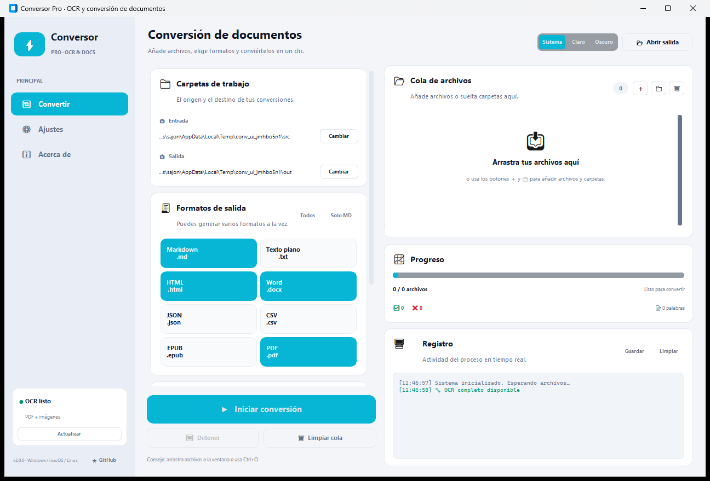

# Conversor Pro

Aplicación de escritorio para convertir **PDF, imágenes, Word, HTML, Markdown, CSV, Excel y EPUB** a múltiples formatos, con OCR opcional y una interfaz moderna.




## ✨ Funciones

- **OCR real** con OCRmyPDF + Tesseract + Ghostscript para PDF escaneados e imágenes.
- **Cola por lotes** con arrastrar y soltar, carpeta de origen, estados por archivo y progreso.
- **8 formatos de salida**: Markdown, TXT, HTML, Word, JSON, CSV, EPUB y PDF.
- **Conversión entre formatos**: DOCX, HTML, Markdown, CSV, Excel y EPUB también se pueden exportar.
- **Ajustes persistentes**: tema, color de acento, idioma OCR, páginas, optimización y más.
- **Interfaz clara**: modo claro/oscuro, panel lateral, registro con colores y atajos de teclado.
- **Sin ventanas negras** de consola en Windows.
- Funciona en **Windows, macOS y Linux**.

## 📥 Formatos de entrada

| Tipo | Extensiones |
|---|---|
| PDF | `.pdf` |
| Imágenes | `.png`, `.jpg`, `.jpeg`, `.tif`, `.tiff`, `.bmp`, `.webp` |
| Word | `.docx` |
| Texto | `.txt`, `.md`, `.markdown` |
| Web | `.html`, `.htm` |
| Hojas de cálculo | `.csv`, `.xlsx` |
| Libros | `.epub` |

## 📤 Formatos de salida

| Formato | Extensión | Contenido |
|---|---|---|
| Markdown | `.md` | Títulos, listas y tablas |
| Texto plano | `.txt` | Texto limpio |
| HTML | `.html` | Página autocontenida con estilos y TOC |
| Word | `.docx` | Estilos, tablas y numeración de páginas |
| JSON | `.json` | Metadatos, bloques y páginas |
| CSV | `.csv` | Texto por página o tabla original |
| EPUB | `.epub` | Libro electrónico compatible con lectores |
| PDF | `.pdf` | PDF con OCR o PDF generado desde el documento |

## 🚀 Instalación

1. Clona el repositorio:

   ```bash
   git clone https://github.com/afc00073-lab/conversor.git
   cd conversor
   ```

2. Crea un entorno virtual (recomendado):

   ```bash
   python -m venv .venv
   .venv\Scripts\activate      # Windows
   # source .venv/bin/activate # macOS / Linux
   ```

3. Instala las dependencias:

   ```bash
   pip install -r requirements.txt
   ```

4. Ejecuta la aplicación:

   ```bash
   python main.py
   ```

## 🧠 Configurar OCR

La app funciona sin OCR para documentos que ya tienen texto. Para leer escaneos e imágenes necesitas:

### Tesseract

- **Windows**: descarga el instalador de [UB Mannheim](https://github.com/UB-Mannheim/tesseract/wiki) y marca los idiomas que necesites. Añade `C:\Program Files\Tesseract-OCR` al `PATH`.
- **macOS**: `brew install tesseract tesseract-lang`
- **Linux**: `sudo apt install tesseract-ocr tesseract-ocr-spa`

### Ghostscript (necesario para OCRmyPDF en Windows)

- Descarga desde [ghostscript.com/releases](https://ghostscript.com/releases/gsdnld.html).
- Añade `C:\Program Files\gs\...\bin` al `PATH`.

Puedes comprobar el estado desde **Ajustes → Herramientas OCR** o ejecutando:

```bash
python main.py --diagnose
```

## 🖱️ Uso rápido

1. Añade archivos con **＋**, una carpeta con **📁** o arrástralos a la ventana.
2. Elige uno o varios formatos de salida.
3. Configura el idioma OCR y, si quieres, un rango de páginas (`1-5, 8`).
4. Pulsa **Iniciar conversión**.
5. Los resultados aparecen en la carpeta de salida. Puedes abrirla con **Abrir salida**.

## ⌨️ Atajos

| Atajo | Acción |
|---|---|
| `Ctrl + O` | Añadir archivos |
| `Ctrl + Mayús + O` | Añadir carpeta |
| `F5` | Iniciar conversión |
| `Esc` | Detener el proceso |
| `Ctrl + L` | Limpiar el registro |
| `Ctrl + Q` | Cerrar la aplicación |

## 🗂️ Estructura del proyecto

```
conversor/
├── main.py                 # Punto de entrada
├── conversor/
│   ├── config.py           # Configuración persistente y constantes
│   ├── model.py            # Modelo intermedio de documento
│   ├── extract.py          # Lectura de todos los formatos
│   ├── ocr.py              # OCRmyPDF, Tesseract y Ghostscript
│   ├── render.py           # Renderizadores de salida
│   ├── pipeline.py         # Orquestación de la conversión
│   └── ui/
│       ├── app.py          # Ventana principal
│       ├── theme.py        # Paleta visual
│       └── widgets.py      # Widgets reutilizables
├── tests/
├── requirements.txt
└── README.md
```

## 🧪 Pruebas

```bash
python -m pytest -q
```

Las pruebas cubren los renderizadores y la extracción de texto, HTML, Markdown y CSV sin necesidad de OCR.

## 📦 Crear un ejecutable

Con PyInstaller:

```bash
pip install pyinstaller
pyinstaller --noconfirm --windowed --name "Conversor Pro" main.py
```

El ejecutable queda en `dist/Conversor Pro/`.

## ⚠️ Notas

- OCRmyPDF, Tesseract y Ghostscript son herramientas externas; la app detecta su estado y avisa si faltan.
- La generación de PDF desde DOCX/HTML/EPUB usa `reportlab` y una fuente Unicode del sistema.
- Los documentos protegidos con contraseña no se pueden abrir.
- El OCR puede tardar varios minutos en PDF extensos; el botón **Detener** termina al acabar el archivo actual.

## 📄 Licencia

MIT. Consulta [LICENSE](LICENSE).

Hecho con CustomTkinter, OCRmyPDF, Tesseract, pypdf, python-docx, BeautifulSoup, reportlab y Pillow.
